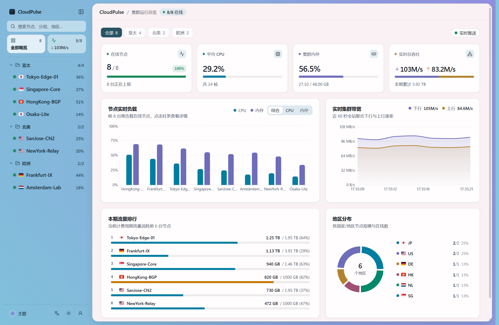

# monitor-theme-design

[monitor](https://github.com/monitor-probe/monitor) 的公开页主题。

Fork 自 [stqfdyr/monitor-theme-serverstatus](https://github.com/monitor-probe/monitor-theme-serverstatus)，融合原生 Arc 自由调色渐变背景、tweakcn(ShadcnUI) Tokens 与胶片颗粒磨砂质感的现代化监控主题。



## 特性

- **原生 Arc 主题背景**：支持 2D 点阵自由色盘（1~3 个独立可拖拽颜色圆点）、一键随机配色、5 页 Arc 原生色板，自动派生深浅双半面背景与和谐强调色。
- **双模式切换**：支持「Arc 背景」与「经典纯色（Claude / Vercel / Twitter / Default）」自由切换，均完整支持浅色 / 跟随系统 / 深色模式。
- **无级质感微调**：原生 Arc 波浪显色强度滑块、20 点环形颗粒旋钮与卡片磨砂透光调节，站长登录后可一键保存为全站默认外观。
- **监控页筛选**：上方按搜索、分组、地区、系统、在线状态筛选节点，下方查看图表，桌面端与移动端布局一致。

## 路由

- `/`：服务器状态列表
- `/node/{id}`：单节点历史监控与延迟图表

## 安装

### 方法一：后台上传压缩包

1. 在 [Releases](https://github.com/tom2almighty/monitor-theme-design/releases) 页面下载最新的 `theme.tar.gz`。
2. 登录 monitor hub 后台，进入「主题」管理页面。
3. 上传 `theme.tar.gz` 完成安装。卡片上的 ⟳ 按钮可检查本仓库是否有新版本。

### 方法二：解压至目录

将 release 产物解压到 hub 所在主机 `--themes` 目录下的 `monitor-theme-design/` 文件夹：

```bash
mkdir -p /path/to/monitor/themes/monitor-theme-design
tar -xzf theme.tar.gz -C /path/to/monitor/themes/monitor-theme-design
```

然后在后台「主题」页刷新并选中切换。

## 协议与致谢

- 本项目基于 [MIT License](LICENSE) 开源。
- 感谢 [monitor-probe/monitor](https://github.com/monitor-probe/monitor)。
- 感谢 [stqfdyr](https://github.com/stqfdyr) 的原版 [monitor-theme-serverstatus](https://github.com/monitor-probe/monitor-theme-serverstatus) 主题。
- 国旗图标来自 [flag-icons](https://github.com/lipis/flag-icons)，MIT 协议。